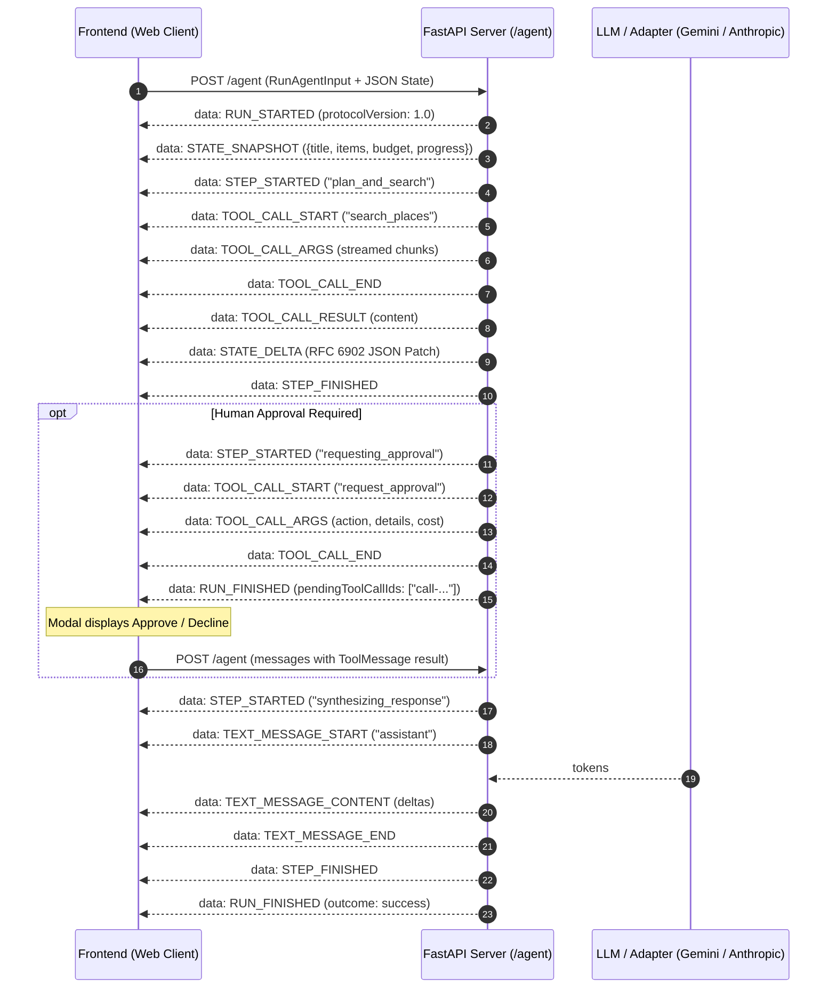

# AG-UI Task Copilot

A production-grade implementation of the Agent-User Interaction (AG-UI 1.0) protocol with streaming Server-Sent Events, RFC 6902 shared state synchronization, tool-call tracking, and human-in-the-loop approvals.

## Architecture



## Quickstart (Under 5 Commands)

```bash
git clone <repo-url> ag-ui
cd ag-ui
py -3.11 -m pip install -r requirements.txt
py -3.11 -m uvicorn server:app --reload --port 8000
```
Open `http://localhost:8000` in your browser.

## UI Features to AG-UI Event Mapping

| UI Component / Feature | AG-UI 1.0 Event | Description |
| :--- | :--- | :--- |
| **Run Status & Stop Control** | `RUN_STARTED` / `RUN_FINISHED` | Signals active execution, enables AbortController `Stop` button, and resets controls on finish. |
| **Error Banner** | `RUN_ERROR` | Displays server exceptions or validation failures cleanly with error code. |
| **Step Timeline Badges** | `STEP_STARTED` / `STEP_FINISHED` | Renders dynamic pill with pulsing active status, updating to green check on step completion. |
| **Live Plan Panel** | `STATE_SNAPSHOT` / `STATE_DELTA` | Replaces state wholesale at run open and applies RFC 6902 atomic JSON patches live. |
| **Tool Execution Cards** | `TOOL_CALL_START`, `ARGS`, `END`, `RESULT` | Displays card for server tools (`search_places`), streams argument tokens, and renders output. |
| **Approval Modal (HITL)** | `TOOL_CALL_START` + `pendingToolCallIds` | Pauses execution for frontend tool `request_approval`, awaiting user action before resumption. |
| **Assistant Chat Stream** | `TEXT_MESSAGE_START`, `CONTENT`, `END` | Streams LLM assistant response incrementally without waiting for run completion. |
| **Event Inspector** | All protocol events | Collapsible raw stream logger with type filters, timestamps, and formatted JSON inspection. |

## Running Tests

Run backend event sequencing and lifecycle tests:
```bash
py -3.11 -m pytest -v test_server.py
```

Run frontend state patch reducer tests:
```bash
node --test reducer.test.js
```
