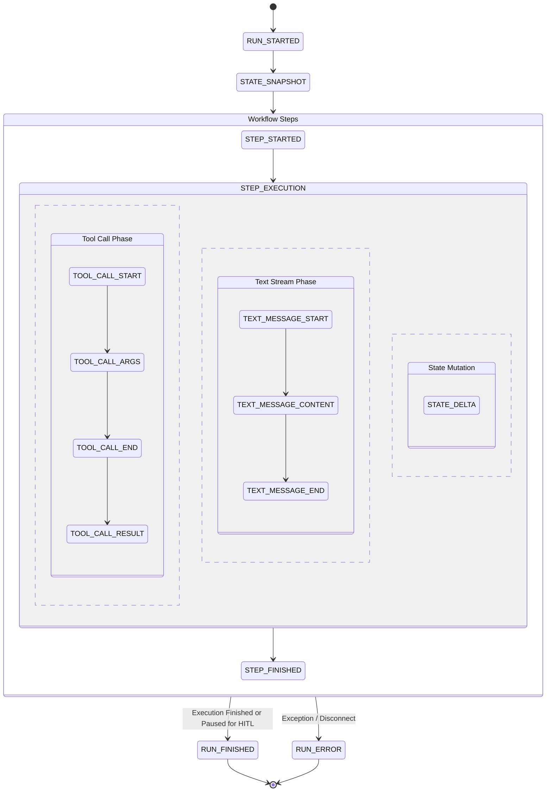
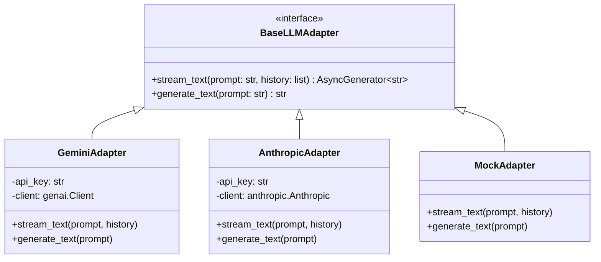

# Technical Documentation: AG-UI Task Copilot

**Version:** 1.0.0  
**Protocol Standard:** Agent-User Interaction Protocol (AG-UI 1.0)  
**Implementation Architecture:** Client-Server Streaming SSE + Reactive Web Client  
**Primary Language Stack:** Python 3.11+ (FastAPI, Uvicorn) & Modern Vanilla JavaScript (ES2022)

---

## Table of Contents
1. [Executive Summary](#1-executive-summary)
2. [High-Level Architecture](#2-high-level-architecture)
3. [AG-UI 1.0 Protocol & Lifecycle Specification](#3-ag-ui-10-protocol--lifecycle-specification)
4. [Shared State Synchronization & RFC 6902 Patching](#4-shared-state-synchronization--rfc-6902-patching)
5. [Human-In-The-Loop (HITL) Approval Pattern](#5-human-in-the-loop-hitl-approval-pattern)
6. [Backend Service Deep Dive](#6-backend-service-deep-dive)
7. [LLM Adapter Subsystem](#7-llm-adapter-subsystem)
8. [Tool Execution & Extraction Subsystem](#8-tool-execution--extraction-subsystem)
9. [Frontend Client Architecture](#9-frontend-client-architecture)
10. [API Reference & Payload Schemas](#10-api-reference--payload-schemas)
11. [Testing & Quality Assurance](#11-testing--quality-assurance)
12. [Configuration & Environment Security](#12-configuration--environment-security)

---

## 1. Executive Summary

**AG-UI Task Copilot** is a reference implementation of the **Agent-User Interaction (AG-UI 1.0)** protocol. It provides a real-time, interactive environment connecting autonomous AI agents with human end-users.

Unlike traditional conversational chat bots that produce unstructured markdown responses, AG-UI treats the agent interaction as an observable, multi-step distributed state machine. Key capabilities include:

- **Strict Event-Driven Streaming:** Communication over Server-Sent Events (SSE) with typed events (`RUN_*`, `STEP_*`, `TOOL_*`, `STATE_*`, `TEXT_*`).
- **RFC 6902 Shared State Synchronization:** Synchronizes an evolving application data model (e.g., trip plans, budgets, item statuses) between server and client using minimal, atomic JSON Patch operations.
- **Two-Phase Human-in-the-Loop (HITL) Execution:** Automatically suspends execution when high-risk actions (e.g., booking, financial expense) require explicit human approval, allowing state inspection and resumption without losing thread context.
- **Pluggable Multi-LLM Provider Engine:** Out-of-the-box support for Google Gemini (via `google-genai`), Anthropic Claude, and an offline mock provider for deterministic CI/CD pipelines.

---

## 2. High-Level Architecture

The system consists of two primary runtime tiers:
1. **Frontend Presentation Tier (`index.html`):** A lightweight client built with Vanilla JavaScript and TailwindCSS. It parses chunked SSE streams, runs an in-memory RFC 6902 patch reducer, drives interactive modals, and renders live timeline badges.
2. **Backend Application Tier (`server.py`, `adapters.py`, `tools.py`):** An asynchronous FastAPI application that processes incoming runs, orchestrates multi-step workflows, extracts structured parameters, executes internal tools, and streams AG-UI protocol events.

```mermaid
graph TB
    subgraph "Client Layer (Browser)"
        UI["Web Interface (index.html)"]
        StreamReader["SSE Stream Reader / Parser"]
        StateReducer["RFC 6902 Patch Reducer"]
        EventLog["Event Inspector Telemetry"]
        ApprovalModal["Human Approval Modal"]
    end

    subgraph "API / Transport Layer"
        FastAPIApp["FastAPI Server (/agent)"]
        SSEPipe["text/event-stream Pipe"]
        Cors["CORS Middleware"]
    end

    subgraph "Application Core"
        Orchestrator["Agent Workflow Generator (stream_agent)"]
        StateEngine["JSON Patch Generator (jsonpatch)"]
        EventEncoder["AG-UI EventEncoder"]
    end

    subgraph "Tool & Extraction Layer"
        TripExtractor["extract_trip_info()"]
        PlacesDB["PLACES_DB Heuristic / Mock DB"]
        ToolRegistry["Tool Declarations (/tools)"]
    end

    subgraph "LLM Provider Abstraction"
        AdapterFactory["get_llm_adapter()"]
        GeminiAd["GeminiAdapter (google-genai)"]
        ClaudeAd["AnthropicAdapter (anthropic)"]
        MockAd["MockAdapter (offline deterministic)"]
    end

    UI -->|POST /agent (RunAgentInput)| FastAPIApp
    FastAPIApp --> Orchestrator
    Orchestrator --> StateEngine
    Orchestrator --> TripExtractor
    TripExtractor --> PlacesDB
    TripExtractor --> AdapterFactory
    Orchestrator --> AdapterFactory
    AdapterFactory --> GeminiAd
    AdapterFactory --> ClaudeAd
    AdapterFactory --> MockAd
    Orchestrator --> EventEncoder
    EventEncoder --> SSEPipe
    SSEPipe -->|data: Events| StreamReader
    StreamReader --> StateReducer
    StreamReader --> UI
    StreamReader --> EventLog
    StreamReader --> ApprovalModal
```

---

## 3. AG-UI 1.0 Protocol & Lifecycle Specification

The AG-UI 1.0 protocol defines a strict lifecycle for agent runs. All communication from the server to the client is delivered as SSE frames (`Content-Type: text/event-stream`), where each data line contains a serialized JSON event.

### 3.1 Event Taxonomy

| Event Type | Category | Description | Payload Attributes |
| :--- | :--- | :--- | :--- |
| `RUN_STARTED` | Run Lifecycle | Signals commencement of run execution. | `threadId`, `runId`, `protocolVersion` |
| `RUN_FINISHED` | Run Lifecycle | Terminal event signaling run completion. | `threadId`, `runId`, `outcome` (`status`, `pendingToolCallIds`) |
| `RUN_ERROR` | Run Lifecycle | Terminal event emitted on catastrophic failure. | `message`, `code` |
| `STEP_STARTED` | Workflow Step | Indicates entry into a discrete workflow phase. | `stepName` |
| `STEP_FINISHED` | Workflow Step | Indicates completion of a workflow phase. | `stepName` |
| `TOOL_CALL_START` | Tool Execution | Marks the initiation of a tool call. | `toolCallId`, `toolCallName` |
| `TOOL_CALL_ARGS` | Tool Execution | Streams partial JSON argument chunks. | `toolCallId`, `delta` |
| `TOOL_CALL_END` | Tool Execution | Closes tool argument streaming. | `toolCallId` |
| `TOOL_CALL_RESULT`| Tool Execution | Returns tool execution output. | `messageId`, `toolCallId`, `content` |
| `STATE_SNAPSHOT` | State Sync | Full baseline snapshot of shared state. | `snapshot` |
| `STATE_DELTA` | State Sync | RFC 6902 JSON patch applied to state. | `delta` (Array of patch operations) |
| `TEXT_MESSAGE_START` | Chat Stream | Begins assistant message block. | `messageId`, `role` |
| `TEXT_MESSAGE_CONTENT` | Chat Stream | Token delta streamed from LLM. | `messageId`, `delta` |
| `TEXT_MESSAGE_END` | Chat Stream | Closes assistant message block. | `messageId` |

### 3.2 Protocol Lifecycle Invariants

The implementation enforces the following structural invariants:
1. **Scope Encapsulation:** Every `*_START` event MUST have a corresponding `*_END` or `*_FINISHED` event.
2. **Stack Discipline:** Nested elements (e.g., tool calls within a step) must complete prior to the enclosing step finishing.
3. **Single Terminal Event:** Every run terminates with exactly one of `RUN_FINISHED` or `RUN_ERROR`.
4. **Initial State Baseline:** A `STATE_SNAPSHOT` event MUST precede any `STATE_DELTA` events within a run.



---

## 4. Shared State Synchronization & RFC 6902 Patching

The shared state enables the agent and client to operate on a single source of truth without full-document retransmissions.

### 4.1 State Schema
```typescript
interface SharedPlanState {
  title: string;          // Human-readable itinerary or project title
  items: PlanItem[];      // Collection of activities, reservations, or tasks
  budget: number;         // Total calculated or allocated budget
  progress: number;       // Execution progress percentage (0 - 100)
}

interface PlanItem {
  id: string;             // Unique identifier (e.g. "item-a3b1c2")
  title: string;          // Name of attraction, hotel, or activity
  type: string;           // Category: "Hotel", "Museum", "Historic", etc.
  cost: number;           // Monetary cost in USD
  rating: number;         // User review rating (0.0 - 5.0)
  day: number;            // Itinerary schedule day (1-indexed)
  status: "planned" | "pending_approval" | "confirmed" | "declined";
}
```

### 4.2 Server-Side Patch Generation
The server keeps `old_state` and `current_state` references. Whenever changes are made, it computes an RFC 6902 delta:
```python
import copy
import jsonpatch

old_state = copy.deepcopy(current_state)
# ... perform mutations ...
current_state["progress"] = 50
patch = jsonpatch.make_patch(old_state, current_state).patch
if patch:
    yield encoder.encode(StateDeltaEvent(delta=patch))
```

### 4.3 Client-Side Patch Reducer (`applyPatch`)
The frontend applies operations sequentially in pure JavaScript without external dependencies:
- **`add`:** Inserts into arrays (`/items/-` or index) or sets object properties.
- **`replace`:** Overwrites an existing key value.
- **`remove`:** Deletes array indices via `splice` or removes object keys.

---

## 5. Human-In-The-Loop (HITL) Approval Pattern

The HITL workflow pauses autonomous agent execution when actions exceed predefined thresholds (e.g., booking expensive hotels, financial transactions).

### 5.1 HITL Sequence Flow

```mermaid
sequenceDiagram
    autonumber
    participant Browser as Browser Client
    participant Server as FastAPI Server
    participant Model as LLM / Adapter

    Browser->>Server: POST /agent (Initial Query: "Book a hotel in Paris")
    Server-->>Browser: RUN_STARTED
    Server-->>Browser: STATE_SNAPSHOT
    Server-->>Browser: STEP_STARTED ("plan_and_search")
    Server-->>Browser: TOOL_CALL_START ("search_places")
    Server-->>Browser: TOOL_CALL_ARGS (query: "Paris")
    Server-->>Browser: TOOL_CALL_END
    Server-->>Browser: TOOL_CALL_RESULT ([places])
    Server-->>Browser: STATE_DELTA (items added with status: "planned")
    Server-->>Browser: STEP_FINISHED

    rect rgb(40, 30, 20)
        Note over Server,Browser: Two-Phase Pause Trigger
        Server-->>Browser: STEP_STARTED ("requesting_approval")
        Server-->>Browser: TOOL_CALL_START ("request_approval")
        Server-->>Browser: TOOL_CALL_ARGS (action, details, cost: $220)
        Server-->>Browser: TOOL_CALL_END
        Server-->>Browser: STEP_FINISHED
        Server-->>Browser: RUN_FINISHED (outcome.pendingToolCallIds: ["call-approval-xyz"])
    end

    Note over Browser: Modal displays Action, Details & Cost.<br/>User clicks "Approve".

    Browser->>Server: POST /agent (Messages including ToolMessage result: { approved: true })
    Server-->>Browser: RUN_STARTED
    Server-->>Browser: STEP_STARTED ("processing_approval")
    Server-->>Browser: STATE_DELTA (item status changed to "confirmed", budget recalculated)
    Server-->>Browser: STEP_FINISHED
    Server-->>Browser: STEP_STARTED ("responding")
    Server-->>Browser: TEXT_MESSAGE_START ("assistant")
    Model-->>Server: Stream tokens
    Server-->>Browser: TEXT_MESSAGE_CONTENT (deltas)
    Server-->>Browser: TEXT_MESSAGE_END
    Server-->>Browser: STEP_FINISHED
    Server-->>Browser: STATE_DELTA (progress: 100)
    Server-->>Browser: RUN_FINISHED (outcome: success, no pending calls)
```



### 5.2 Resumption Message Contract
Upon approval or rejection, the client appends a message with `role: "tool"`:
```json
{
  "id": "msg-8f7e2a1b",
  "role": "tool",
  "toolCallId": "call-approval-xyz",
  "content": "{\"approved\": true}"
}
```
The server checks `get_last_tool_message(messages)`. If present, it executes the reconciliation branch rather than starting a new search.

---

## 6. Backend Service Deep Dive

### 6.1 Server Architecture (`server.py`)
- **FastAPI Core:** Exposes streaming endpoints and static asset serving.
- **Asynchronous Generator (`stream_agent`):** Manages coroutine-based execution, yielding event strings line-by-line.
- **Client Disconnect Detection:** Uses `await request.is_disconnected()` prior to yielding chunks. If the client disconnects or aborts, the generator catches `asyncio.CancelledError`, cleans up unclosed frames, and safely closes the stream.
- **CORS Middleware:** Configured with permissive headers for seamless multi-origin local development.

### 6.2 Stream Buffer & Header Configuration
```python
return StreamingResponse(
    stream_agent(run_input, request),
    media_type="text/event-stream",
    headers={
        "Cache-Control": "no-cache",
        "Connection": "keep-alive",
        "X-Accel-Buffering": "no", # Disables proxy response buffering (e.g. Nginx)
    }
)
```

---

## 7. LLM Adapter Subsystem

The LLM abstraction resides in `adapters.py` and provides a unified interface across providers.



### 7.1 Provider Resolution Strategy
`get_llm_adapter()` inspects `LLM_PROVIDER`:
1. `gemini` (Default): Uses `google-genai` SDK v2.0+. Iterates through `CANDIDATE_MODELS` (`gemini-3.5-flash`, `gemini-3.7-flash`, `gemini-3.8-flash`, `gemini-flash-latest`) for resilience against per-model rate limits.
2. `anthropic`: Uses official `anthropic` SDK targeting `claude-3-5-sonnet-latest`.
3. `mock`: Simulates realistic token-by-token streaming with simulated delays without requiring external network connectivity or API keys.

---

## 8. Tool Execution & Extraction Subsystem

Located in `tools.py`, this module handles query understanding and simulated data sources:
- **`extract_trip_info(query, adapter)`:** Uses the active LLM adapter with a strict JSON system prompt to extract destination, itinerary duration, and attractions. If LLM extraction is unavailable, it falls back to regex-based heuristics (`parse_destination_fallback`).
- **`PLACES_DB`:** Curated destination knowledge base (London, Goa, Kyoto, Paris, Kolhapur) including attraction ratings, costs, categories, and luxury stays.
- **`get_frontend_tools_declaration()`:** Exports JSON schemas for client-side tools (`request_approval`).

---

## 9. Frontend Client Architecture

The frontend is implemented in `index.html` as a responsive, dependency-free Single Page Application (SPA).

### 9.1 Component Layout
- **Header Bar:** Thread identifier, Reset ("New Thread"), Retry, and Abort ("Stop") controls.
- **Timeline Step Badges (`#steps-bar`):** Live badges showing active steps (pulsing indigo) and completed steps (emerald check).
- **Conversation Stream (`#chat-messages`):** Chat interface displaying user queries, assistant responses, and inline tool execution cards.
- **Shared State Panel (`#plan-items`):** Rendered itinerary grouped by day, displaying costs, ratings, progress bar, and approval badges.
- **Real-Time Event Inspector (`#event-log`):** Diagnostic console capturing raw SSE events with filtering (`RUN_`, `STEP_`, `TOOL_`, `STATE_`, `TEXT_`) and JSON tree expansion.
- **Approval Modal (`#approval-modal`):** Glassmorphic modal presenting pending HITL decisions.

### 9.2 SSE Parser Engine
Since standard browser `EventSource` only supports HTTP GET, the client utilizes the Fetch API with `ReadableStreamDefaultReader` to issue `POST` requests while processing streaming bodies:
```javascript
const reader = response.body.getReader();
const decoder = new TextDecoder("utf-8");
let buffer = "";

while (true) {
    const { done, value } = await reader.read();
    if (done) break;
    buffer += decoder.decode(value, { stream: true });
    const lines = buffer.split("\n\n");
    buffer = lines.pop(); // Keep incomplete chunk in buffer

    for (const block of lines) {
        for (const line of block.split("\n")) {
            if (line.startsWith("data:")) {
                const ev = JSON.parse(line.slice(5).trim());
                handleEvent(ev);
            }
        }
    }
}
```

---

## 10. API Reference & Payload Schemas

### 10.1 `POST /agent`
Initiates or resumes an agent run.

**Request Headers:**
- `Content-Type: application/json`
- `Accept: text/event-stream`

**Request Body (`RunAgentInput`):**
```json
{
  "threadId": "thr-4b2a8d1e",
  "runId": "run-9f3c1a2e",
  "protocolVersion": "1.0",
  "messages": [
    {
      "id": "msg-1",
      "role": "user",
      "content": "Plan a 3-day trip to Kyoto"
    }
  ],
  "tools": [
    {
      "name": "request_approval",
      "description": "Request human approval for sensitive actions",
      "parameters": {
        "type": "object",
        "properties": {
          "action": { "type": "string" },
          "details": { "type": "string" },
          "cost": { "type": "number" }
        },
        "required": ["action", "details"]
      }
    }
  ],
  "state": {
    "title": "Trip & Project Itinerary",
    "items": [],
    "budget": 1200,
    "progress": 0
  },
  "context": [],
  "forwardedProps": {}
}
```

**Response:** Stream of Server-Sent Events (`text/event-stream`).

### 10.2 Auxiliary Endpoints
- `GET /agent`: Health check and endpoint metadata.
- `GET /tools`: Returns frontend tool declarations.
- `GET /`: Serves `index.html`.

---

## 11. Testing & Quality Assurance

The codebase includes automated test suites covering both backend protocol compliance and frontend state logic.

### 11.1 Backend Protocol Compliance (`test_server.py`)
Utilizes `pytest-asyncio` and `httpx.ASGITransport` to validate:
- Valid `200 OK` response with `text/event-stream` headers.
- Sequential emission of `RUN_STARTED` and initial `STATE_SNAPSHOT`.
- Strict closure of all open step tags (`STEP_STARTED` matching `STEP_FINISHED`).
- Tool call argument streaming integrity (`TOOL_CALL_START` -> `TOOL_CALL_END`).
- Two-phase approval resume flow handling.

Run with:
```bash
# Offline execution using mock adapter
$env:LLM_PROVIDER="mock"; py -3.11 -m pytest -v test_server.py
```

### 11.2 Frontend State Reducer (`reducer.test.js`)
Tests RFC 6902 JSON Patch application using Node.js's native test runner:
- Path parsing with escape sequences (`~1` -> `/`, `~0` -> `~`).
- Atomic item addition, removal, and property replacements.

Run with:
```bash
node --test reducer.test.js
```

---

## 12. Configuration & Environment Security

### 12.1 Environment Configuration (`.env`)
```ini
# Primary LLM provider: gemini | anthropic | mock
LLM_PROVIDER=gemini

# Google Gemini API credentials (required if provider is gemini)
GEMINI_API_KEY=your_gemini_api_key_here

# Anthropic Claude credentials (required if provider is anthropic)
ANTHROPIC_API_KEY=your_anthropic_api_key_here
```

### 12.2 Security Guidelines
- **Credential Protection:** The `.env` file contains sensitive API secrets and is excluded from source control in `.gitignore`. A sanitized template is maintained in `.env.example`.
- **Untracked Artifacts:** Python virtual environments (`.venv/`), bytecode caches (`__pycache__/`), and IDE-specific paths (`.vscode/settings.json`) are ignored to prevent repository bloat and leak of local environment paths.
- **Client Sanitization:** Dynamic content injected into the DOM (e.g., tool arguments, raw messages) is rendered using `textContent` and strict innerHTML templates to prevent XSS.
